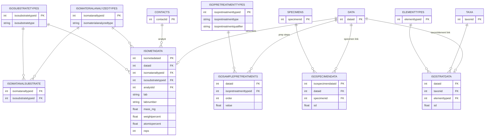
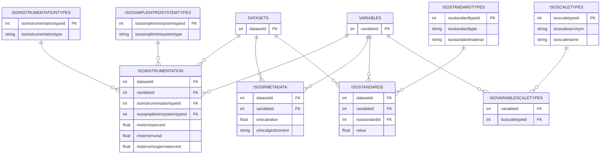
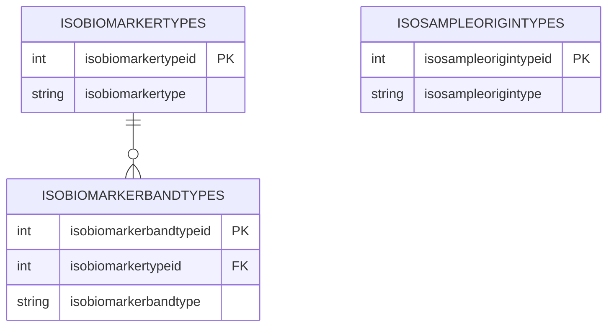

# Neotoma Isotope Schema

The isotope tables in Neotoma split into two levels of granularity, plus a set of standalone lookup tables.

## Row-Level Tables (keyed by DATA)

These tables attach to individual data rows. They describe *what* was measured, how samples were pretreated, and link measurements to specimens or stratigraphic taxa/elements.

---

## Dataset-Level Tables (keyed by DATASETS + VARIABLES)

These tables describe instrumentation, standards, and scales that apply across an entire dataset/variable combination rather than to individual rows.

---

## Biomarker & Sample Origin Lookups

These standalone lookup tables are not currently linked to the core isotope tables above.

